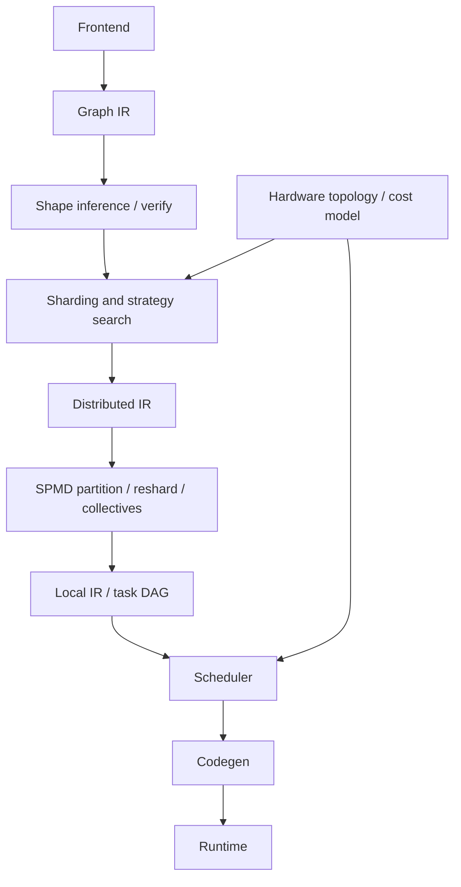

# 架构设计（初稿）

- Graph IR 保留全局张量语义；Distributed IR 记录 mesh 与 placement；Local IR 表示每个 rank 的局部 shape 与通信。
- IR 不依赖 PyTorch、TVM 或 GPU。Frontend 负责导入，backend 负责 lowering，runtime 负责执行。
- 初期静态 shape、单进程逻辑 rank、均匀分片；不支持训练反向、动态 shape 或真实多卡性能。
- Partial 表示尚未完成的归约；不能当作 Replicate。Collective 必须记录 group、归约类型、轴和顺序。
- Pass 应有明确前置条件、结果验证和可重现的 IR dump；不允许无声跳过未实现功能。
- 代价模型使用秒、字节、FLOP；估算与实测分离。真实硬件需校准。
- 接口当前只是初稿，可随学习修订。
